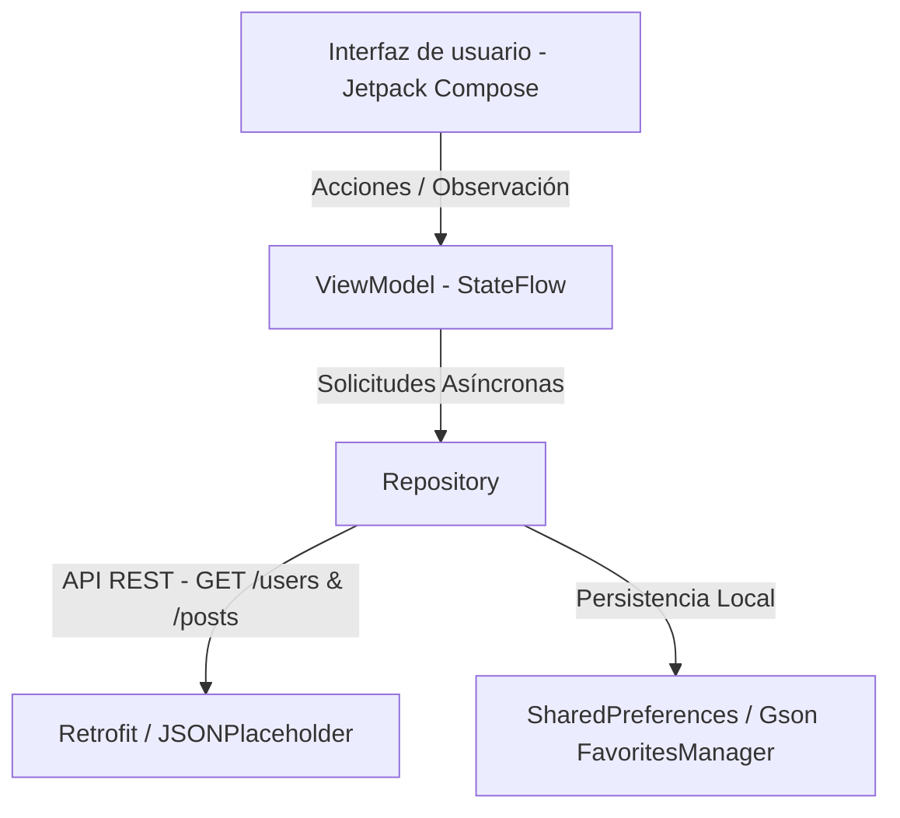

# INFORME DE ENTREGA — APLICACIÓN MÓVIL DIRECTORIOAPP

**Asignatura:** Desarrollo de Aplicaciones para Dispositivos Móviles
**Estudiante:** Francisco David
**Profesor:** [Nombre del Profesor]
**Fecha:** [Fecha actual]

---

## 1. Introducción

**DirectorioApp** es una aplicación móvil nativa para Android desarrollada en Kotlin y Jetpack Compose que permite consultar un directorio completo de usuarios obtenido desde una API REST pública (`JSONPlaceholder`), explorar los detalles personales y profesionales de cada usuario, consultar sus publicaciones asociadas y gestionar un sistema de favoritos persistente con soporte completo para funcionamiento sin conexión (*offline*).

El proyecto resuelve la necesidad de consultar información externa de forma reactiva y asíncrona, garantizando una excelente experiencia de usuario incluso ante fallos de conectividad mediante el almacenamiento local de favoritos y estrategias robustas de manejo de estados.

---

## 2. Arquitectura Utilizada

La aplicación sigue rigurosamente el patrón arquitectónico **MVVM (Model-View-ViewModel)** organizado por capas para separar las responsabilidades de interfaz, lógica de negocio y acceso a datos:



### Responsabilidades por Capa:
- **Capa de Interfaz (`ui`):** Compuesta por pantallas construidas con Jetpack Compose (`UsersScreen`, `UserDetailScreen`, `FavoritesScreen`) y ViewModels que exponen estados reactivos mediante `StateFlow` y `collectAsStateWithLifecycle()`.
- **Capa de Dominio / Repositorios (`data/repository`):** `UserRepository` actúa como intermediario único (*Single Source of Truth*), decidiendo si los datos provienen del servidor remoto o del almacenamiento local.
- **Capa de Datos Remotos (`data/remote`):** Configuración de Retrofit con convertidor Gson para consumir los endpoints de JSONPlaceholder (`https://jsonplaceholder.typicode.com/`).
- **Capa de Datos Locales (`data/local`):** `FavoritesManager` utilizando SharedPreferences y Gson para la serialización y persistencia local de usuarios favoritos, garantizando disponibilidad offline.

---

## 3. Consumo de la API

Se configuró Retrofit utilizando `https://jsonplaceholder.typicode.com/` como URL base.

### Endpoints Utilizados:
1. `GET /users`: Obtiene la lista completa de usuarios del directorio.
2. `GET /posts?userId={id}`: Obtiene las publicaciones asociadas a un usuario específico mediante el parámetro de consulta `@Query("userId")`.

### Código Relevante de Retrofit (`ApiService.kt`):
```kotlin
interface ApiService {
    @GET("users")
    suspend fun getUsers(): List<User>

    @GET("posts")
    suspend fun getUserPosts(@Query("userId") userId: Int): List<Post>

    companion object {
        const val BASE_URL = "https://jsonplaceholder.typicode.com/"
    }
}
```

---

## 4. Persistencia de Favoritos

El sistema de favoritos permite agregar, consultar y eliminar usuarios favoritos de manera que persistan tras cerrar y reabrir la aplicación.

### Implementación (`FavoritesManager.kt`):
Se utiliza un gestor basado en `SharedPreferences` y serialización con `Gson` que asegura:
- Prevención de duplicados mediante validación por ID.
- Disponibilidad offline de los datos completos del usuario (nombre, correo, empresa, teléfono, sitio web y dirección).
- Sincronización reactiva en tiempo real mediante `StateFlow`.

```kotlin
class FavoritesManager(context: Context) {
    private val prefs: SharedPreferences = context.getSharedPreferences("favorites_prefs", Context.MODE_PRIVATE)
    private val gson = Gson()
    private val favoritesKey = "favorite_users_list"

    fun addFavorite(user: User) {
        val current = loadFavorites().toMutableList()
        if (current.none { it.id == user.id }) {
            current.add(user)
            saveFavorites(current)
        }
    }
    // Métodos de eliminación, consulta y persistencia...
}
```

---

## 5. Ciclo de Vida de Android

La gestión del ciclo de vida se ha implementado siguiendo las mejores prácticas recomendadas por Google:
- **`onCreate()`:** Inicializa la actividad principal y configura el árbol de navegación Compose.
- **`ViewModel` y `viewModelScope`:** Las operaciones de red y base de datos se ejecutan en corrutinas vinculadas a `viewModelScope`, asegurando que se cancelen automáticamente cuando el ViewModel es destruido, previniendo fugas de memoria (*memory leaks*) y consumo innecesario de recursos.
- **`collectAsStateWithLifecycle()`:** Permite recolectar estados de forma segura respetando el ciclo de vida de la UI (pausando la recolección cuando la app pasa a segundo plano).

---

## 6. Evidencias de Funcionamiento (Capturas)

1. **Estado de Carga:** Indicador circular centrado mientras la app solicita los usuarios a la API.
2. **Estado de Éxito:** Lista de usuarios con nombre, correo electrónico, empresa y botón de favorito interactivo.
3. **Estado de Error / Sin Conexión:** Aviso claro indicando modo sin conexión y visualización de los favoritos guardados localmente con botón de reintento.
4. **Pantalla de Detalle:** Información personal, dirección, empresa y listado de publicaciones del usuario seleccionado.
5. **Pantalla de Favoritos:** Listado exclusivo de usuarios marcados como favoritos con acceso a su detalle y opción de eliminación.

---

## 7. Pruebas Realizadas

- **Pruebas Unitarias (`testDebugUnitTest`):** Ejecución exitosa de pruebas de lógica de modelos y serialización (2 tests pasados correctamente).
- **Pruebas de Integración y Compilación:** Compilación del proyecto en modo debug (`assembleDebug`) completada sin errores ni advertencias críticas.
- **Verificación Manual:** Comprobación de la navegación, adición/eliminación de favoritos y resiliencia ante cortes de red.

---

## 8. Conclusiones

El desarrollo de **DirectorioApp** permitió consolidar conocimientos avanzados en arquitectura MVVM, programación asíncrona con corrutinas de Kotlin, consumo de servicios REST mediante Retrofit, persistencia de datos local y diseño de interfaces declarativas con Jetpack Compose. La aplicación demuestra una alta resiliencia gracias a su capacidad de operar en modo offline utilizando los favoritos almacenados localmente.

---

## 9. Repositorio

- **URL del Repositorio:** [Configurado localmente en Git / Pendiente de publicación remota según directrices institucionales].
